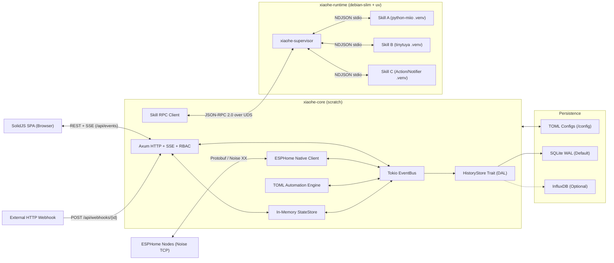

# System Architecture

## 1. High-Level Topology

Xiaohe splits the control plane and the untrusted third-party device driver runtime into **two isolated containers** orchestrated via Docker Compose:

1. **`xiaohe-core`** (`scratch` static Rust binary + embedded SolidJS SPA): Owns the authoritative entity state store, in-process event bus, ESPHome Native API client, HTTP Webhook receiver, declarative TOML automation engine, multi-user RBAC, REST/SSE API, and pluggable `HistoryStore` DAL.
2. **`xiaohe-runtime`** (`debian:bookworm-slim` + `uv` + `xiaohe-supervisor`): Scans `/skills`, provisions per-skill isolated Python virtual environments via `uv`, supervises Skill child processes over `stdin`/`stdout` JSON-RPC 2.0, and bridges them to `xiaohe-core` over a shared Unix Domain Socket (`/run/xiaohe/rpc.sock`).



---

## 2. Core Entity & State Model

Xiaohe models every smart home endpoint as a strongly typed **Entity** belonging to an optional **Device** and **Area** (room).

### 2.1 Identity & Hierarchy

- **Area** (`area_id`, e.g., `living_room`, `bedroom_1`): Logical room or zone used for dashboard grouping and **RBAC authorization**.
- **Device** (`device_id`, e.g., `esphome:esp32_living` or `skill:miio_purifier:air_1`): Physical or logical hardware unit managed by a source (`esphome` or `skill:<skill_id>`).
- **Entity** (`entity_id`, e.g., `light.living_ceiling`, `sensor.bedroom_temp`, `climate.study_ac`): Single controllable or observable capability. Format is `<domain>.<slug>` (lowercase ASCII, digits, underscores).

### 2.2 Strongly Typed Domain Enum

Each entity carries a typed `DomainState` Rust enum so the core, automation validator, and SolidJS frontend share an explicit contract — while `extra` and `custom_actions` provide an escape hatch for non-standard device capabilities.

```rust
#[derive(Debug, Clone, Serialize, Deserialize)]
#[serde(tag = "domain", rename_all = "snake_case")]
pub enum DomainState {
    Light {
        on: bool,
        brightness: Option<u8>,       // 0..=100
        color_temp_k: Option<u16>,    // e.g., 2700..=6500
        rgb: Option<[u8; 3]>,
    },
    Switch {
        on: bool,
    },
    Climate {
        mode: ClimateMode,            // Off | Heat | Cool | Auto | Dry | FanOnly
        target_temp_c: Option<f32>,
        current_temp_c: Option<f32>,
        fan_mode: Option<String>,
    },
    Sensor {
        value: SensorValue,           // Number(f64) | Text(String)
        unit: Option<String>,         // "°C", "%", "W", "kWh", "ppm"
        device_class: Option<String>, // "temperature", "humidity", "power", ...
    },
    BinarySensor {
        active: bool,
        device_class: Option<String>, // "motion", "door", "smoke", "leak", ...
    },
    Cover {
        state: CoverState,            // Open | Opening | Closed | Closing | Stopped
        position: Option<u8>,         // 0 (closed) ..= 100 (open)
    },
    Lock {
        state: LockState,             // Locked | Unlocked | Jammed | Locking | Unlocking
    },
    MediaPlayer {
        state: MediaState,            // Idle | Playing | Paused | Off
        volume: Option<u8>,           // 0..=100
        muted: Option<bool>,
        title: Option<String>,
    },
    Button {
        last_pressed_at: Option<i64>, // Unix ms
    },
    Custom {
        state: String,
    },
}
```

Every `EntityRecord` wraps `DomainState` with uniform metadata:

```rust
pub struct EntityRecord {
    pub entity_id: String,
    pub device_id: Option<String>,
    pub area_id: Option<String>,
    pub name: String,
    pub source: EntitySource, // EspHome { node_id } | Skill { skill_id }
    pub availability: Availability, // Online | Offline | Unknown
    pub state: DomainState,
    pub capabilities: Vec<String>,        // e.g., ["brightness", "color_temp"]
    pub extra: serde_json::Map<String, serde_json::Value>,
    pub custom_actions: Vec<CustomActionDef>,
    pub last_changed_at: i64,             // Server-issued Unix ms
    pub last_updated_at: i64,             // Server-issued Unix ms
}
```

### 2.3 Command Dispatch Flow

1. Client (Web UI, REST API, or Automation Engine) invokes `Command { entity_id, action, params }`.
2. Core checks **RBAC** (for user-initiated calls) and validates `action` + `params` against the entity's domain or declared `custom_actions`.
3. Core routes the command by `entity.source`:
   - `EntitySource::EspHome { node_id }` → sends Protobuf command frame directly over the node's TCP task channel.
   - `EntitySource::Skill { skill_id }` → sends `entity.command` JSON-RPC request via `SkillBridge` to `xiaohe-supervisor` → target Skill's `stdin`.
4. State is updated **optimistically only when the source confirms** (device pushes new state back via ESPHome or `entity.state_changed` RPC), ensuring the StateStore always reflects ground truth.

---

## 3. In-Process Event Bus

`xiaohe-core` uses a typed `tokio::sync::broadcast::Sender<CoreEvent>` with a bounded ring buffer (default capacity: `2048`):

- `EntityStateChanged { entity_id, area_id, old_state, new_state, at }`
- `EntityAvailabilityChanged { entity_id, area_id, availability, at }`
- `WebhookReceived { webhook_id, payload, headers, at }`
- `SkillStatusChanged { skill_id, status, message, at }`
- `AutomationRunRecorded { run_id, automation_id, outcome, at }`

**Subscribers**:
1. **History Writer Task**: Batches state changes and numeric sensor readings and flushes them to `HistoryStore` (e.g., every 500 ms or 64 events) to avoid write amplification on SD cards.
2. **Automation Engine**: Evaluates matching TOML triggers and schedules `for` duration timers.
3. **SSE Fan-Out**: Each connected browser client subscribes to the broadcast channel, filters events by the authenticated user's `Role` + `allowed_areas`, and streams frames. If a client lags behind the broadcast buffer (`RecvError::Lagged`), the server emits a `resync` event instructing the client to refetch snapshots.

---

## 4. Native Protocol Ingestion

### 4.1 ESPHome Native API
- Configured in `config/devices.toml` under `[[esphome.nodes]]` (`id`, `host`, `port`, `noise_psk_secret`, `area_id`).
- Each node runs an independent `tokio::spawn` actor:
  - Performs Noise XX handshake using the decrypted PSK from `secrets.toml`.
  - Queries `ListEntitiesRequest` and registers discovered lights, switches, sensors, binary sensors, climate units, covers, and buttons into `StateStore`.
  - Subscribes to `SubscribeStatesRequest` for zero-polling push updates.
  - Marks all entities of the node `Availability::Offline` on disconnect and reconnects with capped exponential backoff (1 s → 60 s).

### 4.2 HTTP Webhooks
- Configured in `config/system.toml` or referenced directly by automations under `[[webhooks]]` (`id`, `secret_hash`, `enabled`).
- External services (iOS Shortcuts, HomeKit automations, NAS alerts, `tesla-apiscraper-rs` webhooks) `POST /api/webhooks/{webhook_id}` with `Authorization: Bearer <secret>` or `X-Webhook-Secret`.
- Core validates the secret in constant time and emits `CoreEvent::WebhookReceived`.

---

## 5. Data Access Abstraction Layer (DAL)

All historical data and audit logs go through a single async trait:

```rust
#[async_trait]
pub trait HistoryStore: Send + Sync {
    async fn health_check(&self) -> Result<(), StorageError>;

    async fn record_state_batch(&self, records: &[StateHistoryEntry]) -> Result<(), StorageError>;
    async fn record_automation_run(&self, run: &AutomationRunRecord) -> Result<(), StorageError>;

    async fn query_entity_history(
        &self,
        entity_id: &str,
        range: TimeRange,
        bucket_seconds: Option<u32>, // Server-side downsampling for uPlot
    ) -> Result<EntityHistorySeries, StorageError>;

    async fn query_automation_runs(
        &self,
        automation_id: Option<&str>,
        limit: u32,
        offset: u32,
    ) -> Result<Vec<AutomationRunRecord>, StorageError>;

    async fn prune_before(&self, cutoff_unix_ms: i64) -> Result<u64, StorageError>;
}
```

### Implementations
- **`SqliteStore` (Default)**: Single file at `/data/xiaohe.db` with `PRAGMA journal_mode=WAL; PRAGMA synchronous=NORMAL;`. Tables: `entity_state_history`, `numeric_telemetry` (indexed on `(entity_id, ts)`), and `automation_runs`. Supports SQL time-bucketing (`ts / bucket_ms`) for fast `uPlot` rendering.
- **`InfluxDbStore` (Optional)**: Writes numeric telemetry and discrete state transitions via InfluxDB line protocol (`reqwest` + `influxdb` derive types) and executes downsampled `GROUP BY time(...)` queries. Automation audit logs remain lightweight JSON/SQLite or dedicated InfluxDB measurement depending on backend config.

---

## 6. Multi-User RBAC & Security Model

### 6.1 Roles & Permissions

| Role | View Areas/Entities | Control Entities | View History | Manage Automations | Manage Skills | Manage Users & System |
|------|---------------------|------------------|--------------|--------------------|---------------|-----------------------|
| **Admin** | All areas | All areas | All areas | Yes | Yes | Yes |
| **Member** | Assigned `allowed_areas` (or `*`) | Assigned `allowed_areas` | Assigned `allowed_areas` | View only (optional) | No | Self profile only |
| **Guest** | Assigned `allowed_areas` | Assigned `allowed_areas` (excluding `lock` unless explicitly permitted) | No (or last 24h) | No | No | No |

### 6.2 Authentication & Secrets
- **Passwords**: Hashed with Argon2id in `config/users.toml`.
- **Browser Sessions**: Opaque 256-bit random session IDs stored in memory/SQLite, delivered as `HttpOnly`, `SameSite=Lax`, `Secure` (when behind HTTPS) cookies.
- **API Tokens**: Scoped to a specific user (inheriting that user's Role and `allowed_areas`), stored as SHA-256 hashes.
- **Secrets at Rest**: `config/secrets.toml` stores AES-256-GCM ciphertexts encrypted with `XIAOHE_MASTER_KEY`. Secrets are never returned in plaintext over the REST API (write-only update, masked display) and are injected **only** into the specific Skill that declares them in `skill.toml`.

---

## 7. Deployment Topology (`compose.yml`)

```yaml
services:
  xiaohe-core:
    image: ghcr.io/yourorg/xiaohe-core:latest
    ports:
      - "4000:4000"
    environment:
      - XIAOHE_MASTER_KEY=${XIAOHE_MASTER_KEY}
      - XIAOHE_STORAGE_BACKEND=sqlite
      - XIAOHE_RUNTIME_SOCKET=/run/xiaohe/rpc.sock
    volumes:
      - ./config:/config
      - ./data:/data
      - runtime-ipc:/run/xiaohe
    depends_on:
      - xiaohe-runtime
    restart: unless-stopped

  xiaohe-runtime:
    image: ghcr.io/yourorg/xiaohe-runtime:latest
    network_mode: host # Optional: enables LAN broadcast / mDNS discovery for local device Skills
    environment:
      - XIAOHE_RUNTIME_SOCKET=/run/xiaohe/rpc.sock
      - XIAOHE_SKILLS_DIR=/skills
    volumes:
      - ./skills:/skills
      - runtime-ipc:/run/xiaohe
      - uv-cache:/var/cache/uv
    restart: unless-stopped

volumes:
  runtime-ipc:
  uv-cache:
```
